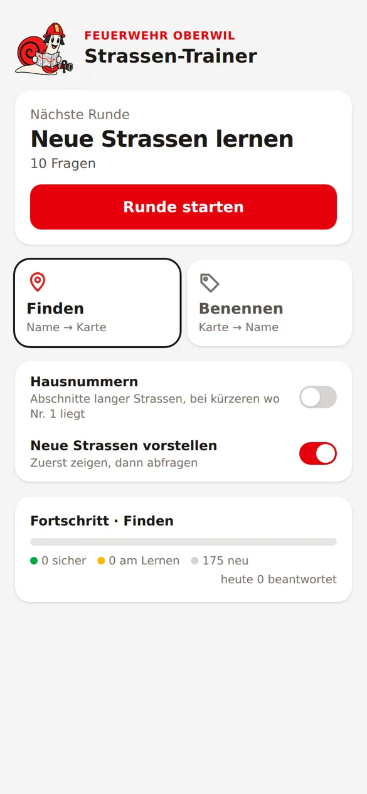
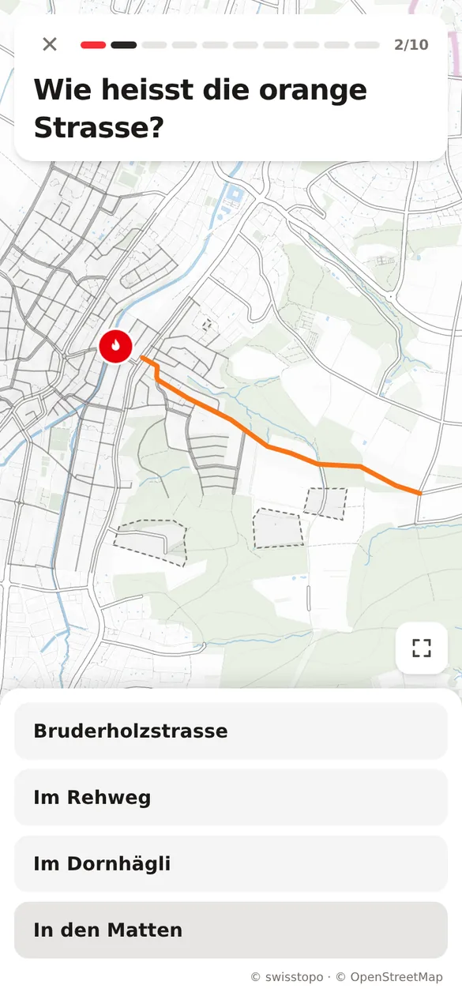
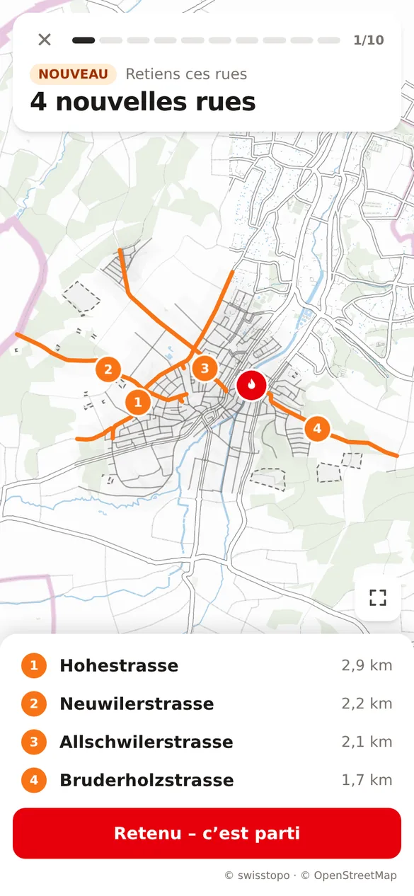
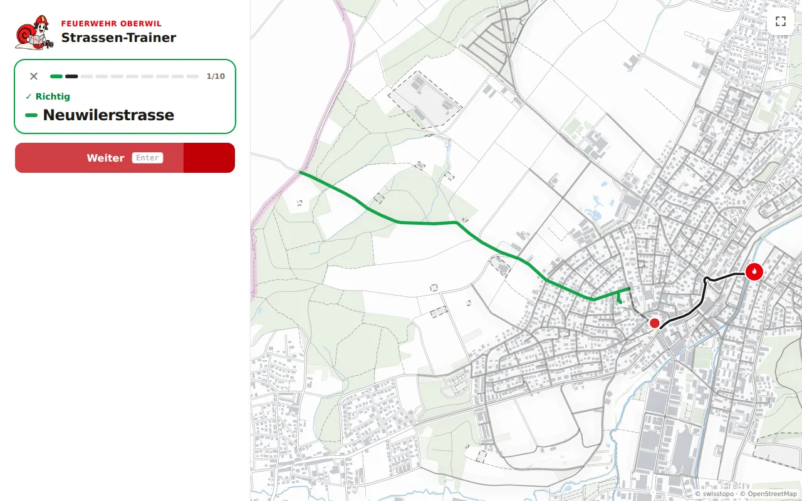

# Strassen-Trainer Oberwil

Web app for Feuerwehr Oberwil drivers to learn the streets of Oberwil BL – phone layout plus a
sidebar layout on desktop (≥ 1024 px).

<p align="center">
  
  
  
</p>
<p align="center">
  
</p>

The app opens on a start screen: what's due, mode, options and progress. Practice happens in rounds
of 10 questions; new streets are first shown a few at a time (all on one map), then asked. Right
answers move on by themselves after 2 s (the «Weiter» button fills up meanwhile), the result of a
wrong one shows in the question card. After every answer a truck drives the route from the
Feuerwehrmagazin to the street, so drivers learn the best way there. The round ends with the misses,
numbered on the map, and «Fehler korrigieren».

- **Strasse finden**: a street or named area is given, tap it on the map, then «Prüfen».
- **Strasse benennen**: one street is highlighted, pick its name from four nearby streets.
- **Hausnummern** (switch, off by default): adds questions like «Hohestrasse – wo liegt Nr. 150–189?»
  for long streets (> 500 m); tap the right section. After answering, all sections show in colour.
  Shorter streets whose numbers clearly run from one end to the other ask «Wo ist Nr. 1?» instead
  (tap an end), and show their lowest and highest number at the ends whenever they appear.

Phones in landscape and screens ≥ 1024 px get a sidebar next to the map. With a mouse, the street
(or section, or end) a click would pick is highlighted.

The map is swisstopo's light base map (buildings, forest, water) with every label removed. Progress
is stored per device in `localStorage` (spaced repetition, Leitner boxes) and decides which questions
a round asks. No backend, no login.

## Set up your town

Any Swiss municipality works. With Node ≥ 22.18, no checkout needed:

```sh
npx strassen-trainer init my-town   # asks for municipality, station address, language, brand → my-town/region.json
cd my-town
npx strassen-trainer data           # downloads swisstopo + OSM data (~220 MB, cached in .cache), builds ./data
npx strassen-trainer build          # ./dist: the app with your town's data – static, host it anywhere
```

Rerun `data` to refresh the data, `build` after any change. Local route knowledge goes into `fixes`
in region.json (see [Data](#data)).

## Development

This repo is laid out like a town folder for Oberwil: `region.json`, `data/` (committed) and `.cache/`.

```sh
pnpm install
pnpm dev        # http://localhost:5173
pnpm lint && pnpm test && pnpm build
```

`pnpm build` runs `vite build`, which writes the town-independent app to `app/`, then
`strassen-trainer build` (from source: `node cli/index.ts build`), which copies it to `dist/` with
Oberwil's data. Pushes to `main` deploy `dist/` to GitHub Pages (`.github/workflows/deploy.yml`).

The CLI lives in `cli/`, runs from source with plain Node (type stripping) and ships compiled to
`cli-dist/`, because Node doesn't strip types under `node_modules`. `npm pack` builds `app/` and
`cli-dist/` (`prepack`); the package contains just those two.

## Region

`region.json` sets the town up: name, brand, language, data source (swisstopo BFS number), the
station's address and local route fixes (barriers OSM lacks, residential streets used as access
roads). `strassen-trainer init` writes it; the data pipeline reads it, and `build` writes the page
title, web manifest and `config.json` (name, brand, language – what the app shows) from it. The shape
is the ArkType schema in `src/region.ts`; every command stops with a readable error when region.json
doesn't match it.

The UI speaks German, French or English (`language`). The copy lives in `src/i18n/`: `de.ts` is the
source, `fr.ts` and `en.ts` must match its shape, so a missing translation fails `tsc`.

## Progress backup

`server/` is a tiny Node service (Hono + built-in SQLite) that stores each device's cards under an
anonymous code like `rot-schnecke-4821`, so progress survives Safari's storage eviction and moves to
a new phone. No accounts, no personal data. The app syncs only when it is built with
`VITE_BACKUP_URL` set; otherwise the backup is off.

```sh
pnpm test                                    # includes server/app.test.ts
node server/main.ts                          # local on :8000, then: VITE_BACKUP_URL=http://127.0.0.1:8000 pnpm dev
```

Oberwil runs it on Railway (project `fwo-strassen`, service `backup`): built from the repo root with
`server/Dockerfile` (service variable `RAILWAY_DOCKERFILE_PATH`), SQLite on a volume at `/data`, app
origins in `ALLOWED_ORIGINS`.

## Data

`data/town.json`, `data/routes.json` and `data/basemap.json` are generated by `strassen-trainer
data` (here committed and prettier-formatted). The app loads them at runtime: `build` copies them
with `config.json` into `dist/data/<content hash>/`, and index.html names that directory, so a cached
index.html never mixes with another deploy's data (`src/townData.ts`). The pipeline in `pipeline/` is
TypeScript run by plain Node (≥ 22.18, no Python or GDAL). To refresh Oberwil's data:

```sh
pnpm data          # all three; downloads (~220 MB swisstopo, OSM via Overpass) are cached in .cache
pnpm data routes   # single steps: town, routes, basemap (routes and basemap read the town.json there)
pnpm test          # includes the pipeline and CLI tests
```

- `pipeline/sources/swisstopo.ts` loads a Swiss town: street names (CSV), street lines and named
  areas from the File Geodatabase (read by the small built-in `filegdb.ts`; swisstopo publishes the
  geometry only as FileGDB or INTERLIS) and building addresses (CSV), all in LV95. A source returns
  raw data in a metric CRS (`pipeline/source.ts`), so other sources can plug in.
- `pipeline/town.ts` builds the items: house-number sections for long streets, numbering ends for
  shorter ones, cross streets, simplified WGS84 geometry.
- `pipeline/routes.ts` routes the truck; `pipeline/basemap.ts` trims swisstopo's light base map.

Routes are the fastest way for a TLF: only roads a truck can use, big access roads preferred, every
turn costs time, one-way streets respected, no route through a barrier. Footpaths and fields get a
route to the nearest drivable point. What the drivers know and OpenStreetMap doesn't (missing
barriers, residential streets they use as access roads) goes into `fixes` in `region.json`.

Sources: swisstopo «Amtliches Strassenverzeichnis» and «Amtliches Gebäudeadressverzeichnis»
(BFS-Nr. 2771); road network © OpenStreetMap contributors (ODbL).

## License

Code: [MIT](LICENSE). Generated data keeps its sources' terms: swisstopo (free use with attribution),
OpenStreetMap-derived routes (ODbL).
